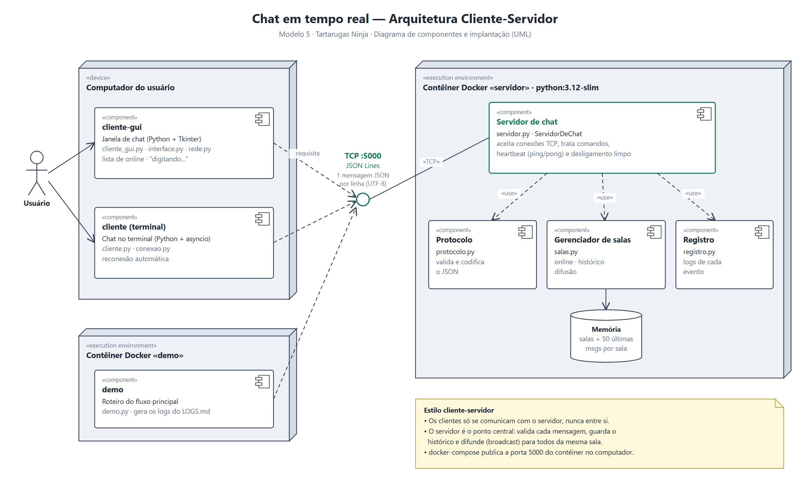

# Trabalho de Análise e Projeto de Sistemas: Arquiteturas de Software

**Disciplina:** Análise e Projeto de Sistemas (Ciência da Computação)  
**Prazo:** 18/11/2026

## Equipe

**Nome do time:** Tartarugas Ninja
**Modelo escolhido:** 5 (1 a 5)

| Nome | Usuário do GitHub |
| --- | --- |
|Eduardo Alves |eduardoal01|
|Linda |lindacristhy|
|Ana |Ana34fd|
|Willames |Williames-C|
|Ryan Yuri|ryan-yuri|

## Modelos

| Modelo | Sistema | Arquitetura principal |
| --- | --- | --- |
| 1 | Delivery de comida | Microsserviços com API Gateway |
| 2 | Monitoramento de sensores | Orientada a eventos |
| 3 | Sistema acadêmico | Camadas (3-tier) |
| 4 | Marketplace com pagamento | Orientada a serviços (SOA) |
| 5 | Chat em tempo real | Cliente-servidor |

Cada modelo pode ser escolhido por **uma equipe só**. A descrição completa de cada modelo está no documento do trabalho, enviado pelo professor.

## Hoje: dia de planejamento

1. Um integrante clica em **Fork** (canto superior direito) e depois em **Create fork**.
2. No fork, em **Settings → Collaborators → Add people**, adicione os colegas.
3. No fork, edite este README (lápis ✏️): nome do time, modelo escolhido e integrantes. Clique em **Commit changes**.
4. Dividam o trabalho e comecem os requisitos em `docs/requisitos.md`.

⚠️ Não editem o repositório do professor, só o fork da equipe.

## O que entregar

| Arquivo | Conteúdo |
| --- | --- |
| `README.md` | Equipe, modelo e **como rodar** o sistema (um comando) |
| `docs/requisitos.md` | 5 requisitos funcionais e 3 não funcionais |
| `docs/arquitetura.png` | Diagrama da arquitetura |
| `docs/sequencia.png` | Diagrama de sequência do fluxo principal |
| `LOGS.md` | Logs do fluxo principal, copiados do terminal |
| `docker-compose.yml` | Ou um script de execução descrito neste README |
| `servicos/` | Uma pasta por componente |

**Cada integrante deve ter pelo menos 3 commits** com mensagens claras.

## Nosso sistema: chat em tempo real (cliente-servidor)

Um **servidor central** em Python recebe as mensagens dos clientes por TCP e as repassa na hora para todos da mesma sala. Os clientes nunca falam entre si, só com o servidor.



| Componente | Pasta | O que faz |
| --- | --- | --- |
| Servidor | [`servicos/servidor`](servicos/servidor) | Salas, usuários online, histórico das últimas 50 mensagens, difusão em tempo real, validação e heartbeat |
| Cliente de terminal | [`servicos/cliente`](servicos/cliente) | Chat no terminal com reconexão automática + roteiro `demo.py` do fluxo principal |
| Cliente gráfico | [`servicos/cliente-gui`](servicos/cliente-gui) | Janela de chat em Tkinter, com lista de online e aviso de "digitando..." |

Tudo em **Python**, usando só a biblioteca padrão (nada de `pip install`).
Documentação: [requisitos](docs/requisitos.md) · [arquitetura e protocolo](docs/arquitetura.md) · [diagrama de sequência](docs/sequencia.png) · [logs do fluxo principal](LOGS.md)

## Como rodar

Pré-requisito: [Docker](https://www.docker.com/products/docker-desktop/) instalado e aberto.

**1. Subir o sistema (um comando):**

```
docker compose up --build
```

O servidor fica escutando na porta **5000**. O build também roda os testes automáticos do servidor.

**2. Executar o fluxo principal** (em outro terminal, na mesma pasta):

```
docker compose run --rm demo
```

Três usuários (ana, bruno e carla) conversam na sala `geral`; cada passo é conferido e o resultado aparece no final (`RESULTADO: fluxo principal concluído com sucesso`). Os logs desse fluxo estão no [`LOGS.md`](LOGS.md).

**3. Conversar de verdade** (opcional; abra dois terminais com nomes diferentes):

```
docker compose run --rm cliente --usuario ana
docker compose run --rm cliente --usuario bruno
```

Ou pela janela gráfica (precisa de Python 3 instalado no computador):

```
python servicos/cliente-gui/cliente_gui.py
```

**Parar tudo:** `Ctrl+C` no terminal do servidor, ou `docker compose down`.

<details>
<summary>Sem Docker (só Python 3.10+)</summary>

```
python servicos/servidor/servidor.py
python servicos/cliente/demo.py
python servicos/cliente/cliente.py --usuario ana
```

Testes do servidor: `python -m unittest discover -s servicos/servidor/tests -v`
</details>

## Entrega

No fork, clique em **Contribute → Open pull request**, preencha o modelo que aparece e clique em **Create pull request**. Um Pull Request por equipe. Cada novo `git push` no fork atualiza o mesmo Pull Request até o prazo.
