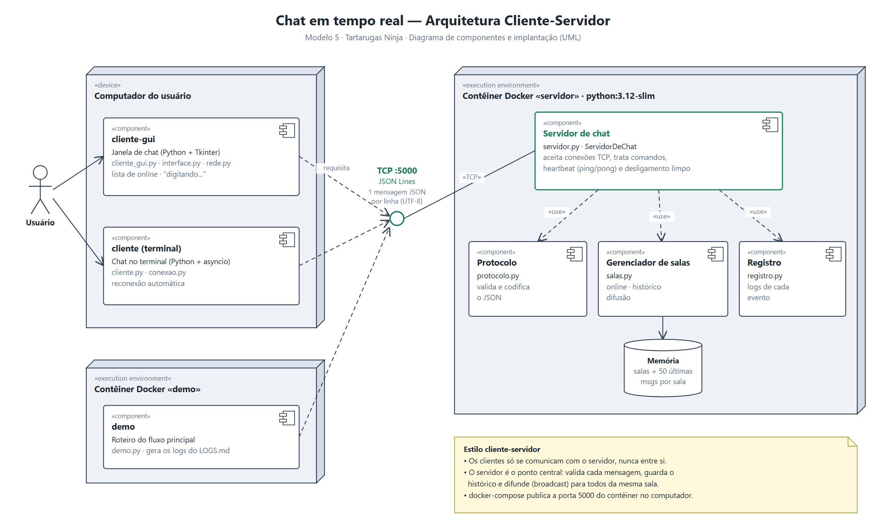
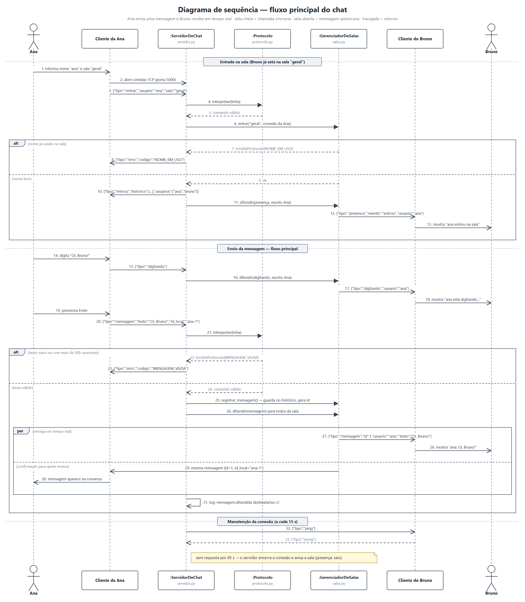

# Arquitetura: cliente-servidor

## Visão geral

O chat segue o estilo **cliente-servidor**: existe **um servidor central** e vários **clientes**. Os clientes nunca conversam diretamente entre si. Toda mensagem vai do cliente para o servidor, e é o servidor que a valida, guarda no histórico e repassa (difunde) para os outros clientes da mesma sala.

| Componente | Pasta | Papel na arquitetura | Tecnologia |
| --- | --- | --- | --- |
| Servidor | `servicos/servidor` | Servidor central: aceita conexões, valida comandos, mantém salas, histórico e usuários online, e difunde as mensagens | Python 3.12, `asyncio` (biblioteca padrão), Docker |
| Cliente de terminal | `servicos/cliente` | Cliente em modo texto, com reconexão automática; inclui o roteiro `demo.py` do fluxo principal | Python 3.12, `asyncio`, Docker |
| Cliente gráfico | `servicos/cliente-gui` | Cliente com janela: lista de online, aviso de "digitando..." e reconexão automática | Python, `tkinter` + `threading` |

### Componentes internos do servidor

| Módulo | Responsabilidade |
| --- | --- |
| `servidor.py` | Abre a porta TCP 5000, cria um objeto `Conexao` por cliente, lê os comandos e responde. Também faz o heartbeat (ping a cada 15 s; derruba quem fica 45 s sem responder) e o desligamento limpo ao receber `SIGTERM`. |
| `protocolo.py` | Define o formato das mensagens e valida tudo o que chega (JSON, tipo, nome, sala, tamanho do texto). |
| `salas.py` | Regra de negócio sem rede: quem está em cada sala, histórico das últimas 50 mensagens e difusão. Por não depender de sockets, é testado com objetos falsos (`tests/test_salas.py`). |
| `registro.py` | Escreve uma linha de log por evento (`usuario.entrou`, `mensagem.difundida`, ...). |

## Protocolo de comunicação

- **Transporte:** TCP, porta **5000**. A conexão fica aberta enquanto o cliente está no chat, e é isso que permite ao servidor *empurrar* mensagens para o cliente em tempo real, sem que ele precise perguntar.
- **Formato:** *JSON Lines*: cada mensagem é um objeto JSON numa única linha, terminada por `\n`, em UTF-8.

| Direção | Tipo | Exemplo |
| --- | --- | --- |
| cliente → servidor | `entrar` | `{"tipo":"entrar","usuario":"ana","sala":"geral"}` |
| cliente → servidor | `mensagem` | `{"tipo":"mensagem","texto":"Oi!","id_local":"ana-1"}` |
| cliente → servidor | `digitando` / `pong` / `sair` | `{"tipo":"digitando"}` |
| servidor → cliente | `entrou` | `{"tipo":"entrou","sala":"geral","historico":[...],"usuarios":["ana"]}` |
| servidor → cliente | `mensagem` | `{"tipo":"mensagem","id":1,"usuario":"ana","texto":"Oi!","enviada_em":"..."}` |
| servidor → cliente | `presenca` | `{"tipo":"presenca","evento":"saiu","usuario":"bruno","usuarios":["ana"]}` |
| servidor → cliente | `digitando` / `ping` / `sistema` | `{"tipo":"ping"}` |
| servidor → cliente | `erro` | `{"tipo":"erro","codigo":"NOME_EM_USO","motivo":"..."}` |

Códigos de erro: `JSON_INVALIDO`, `TIPO_DESCONHECIDO`, `USUARIO_INVALIDO`, `SALA_INVALIDA`, `NOME_EM_USO`, `NAO_ENTROU`, `MENSAGEM_VAZIA`, `MENSAGEM_LONGA`.

## Fluxo principal

1. O cliente abre a conexão TCP e envia `entrar`.
2. O servidor valida o comando (`protocolo.py`), coloca o usuário na sala (`salas.py`) e responde com `entrou`, que traz o histórico e a lista de online. Os outros participantes recebem `presenca`.
3. Quando a Ana envia uma `mensagem`, o servidor valida o texto, guarda no histórico, gera um `id` e difunde para **todos** da sala.
4. O Bruno recebe a mensagem na hora. A Ana recebe a mesma mensagem com o seu `id_local`, o que funciona como confirmação de entrega.

Os logs reais desse fluxo estão em [`LOGS.md`](../LOGS.md).

## Decisões de projeto

| Decisão | Motivo |
| --- | --- |
| TCP com conexão persistente | O servidor pode enviar mensagens a qualquer momento (tempo real), sem o cliente ficar perguntando ("polling"). |
| JSON Lines | Fácil de ler nos logs e de depurar; o `\n` separa uma mensagem da outra no fluxo TCP. |
| `asyncio` no servidor | Atende muitas conexões numa única thread, sem bloquear; é o que sustenta o RNF01. |
| Só biblioteca padrão do Python | Nada para instalar além do Python/Docker (RNF03); o build do Docker também roda os testes. |
| Regra de negócio separada da rede (`salas.py`) | Permite testar salas, histórico e nomes repetidos sem abrir sockets. |
| Sessão no `entrar` | Quando o cliente reconecta com a mesma sessão, o servidor troca a conexão antiga pela nova em vez de recusar o nome. |
| Cliente gráfico com threads | O Tkinter só pode ser alterado pela thread principal; a rede roda em outra thread e entrega os eventos por uma fila (`queue.Queue`). |

## Limitações conhecidas

- O histórico fica **em memória**: se o servidor reiniciar, as mensagens antigas se perdem. Uma evolução natural seria gravá-las em um banco (por exemplo, SQLite).
- Há **um único servidor**, que é ponto único de falha, característica típica do estilo cliente-servidor. Para escalar seria preciso vários servidores e um intermediário (por exemplo, Redis Pub/Sub) para repassar as mensagens entre eles.
- Não há autenticação nem criptografia (TLS): qualquer pessoa na rede pode entrar com um nome livre.
